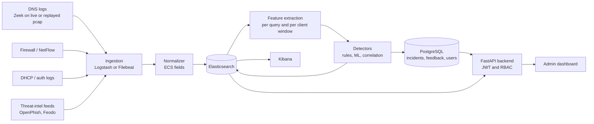

# Architecture and decisions

## Overview

## Life of one DNS query

1. A client asks the resolver for a domain. The query and its reply are captured (live) or replayed from a pcap.
2. Zeek writes one row to `dns.log`. Its `ts` is in epoch seconds.
3. The normalizer converts `ts` to ISO 8601 for `@timestamp` and maps the other fields to ECS (see `data-sources.md`).
4. The event is stored in `dns-logs-*`.
5. The feature job reads recent events and computes features: domain length, entropy, NXDOMAIN ratio, unique subdomains per window.
6. Detectors score the features. Each hit is written to `alerts-*` and as an incident in PostgreSQL.
7. Correlation joins DNS alerts with flow data and threat-intel matches into one incident.
8. Analysts review incidents in Kibana or the admin dashboard and give feedback.

## Index names

`dns-logs-*`, `flows-*`, `dhcp-*`, `ti-*`, `alerts-*`

## Decision: no Kafka

- **Decision:** read directly from Elasticsearch. No message broker.
- **Reason:** one lab, a modest event volume and an 8-week scope. Kafka is another service to run, monitor and debug.
- **Revisit if:** ingestion falls behind during a flood simulation, or buffering and replay beyond what Elasticsearch gives us are needed.
- **Consequence:** the shippers write straight to `dns-logs-*`, and the detection job queries Elasticsearch on a schedule.

## Decision: live capture and replay

Support both. Live capture in the lab network gives realism. Replay with `tcpreplay` and saved pcaps keeps the Week 8 demo independent of live traffic.
