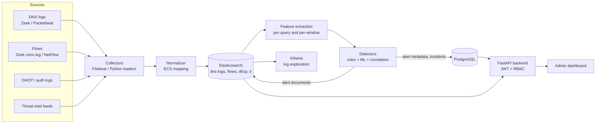

# Architecture

Version 0.1, 19 Oct 2026. This document shows how data flows through the platform and records the main design decisions and their reasons.

## 1. Data flow

Note the difference from the first sketch: feature extraction **reads from Elasticsearch**, it does not sit between the normalizer and the store. This is the result of decision D1 below.

## 2. Components

| Component | Role | Technology | State |
|---|---|---|---|
| Collectors | read logs and feeds, ship them on | Zeek, Filebeat, Python loaders | Week 2 |
| Normalizer | map raw fields to ECS, derive domain fields | Filebeat module / ingest pipeline, Python | Week 2 |
| Elasticsearch | store events, features and alert documents | Elasticsearch 8.15.3 | running |
| Kibana | explore logs and visualize | Kibana 8.15.3 | running |
| Feature extraction | compute lexical and window features | Python module | Week 3 |
| Detectors | rules, ML models, correlation into incidents | Python, scikit-learn | Weeks 4 and 5 |
| PostgreSQL | users, roles, alert metadata, whitelist, audit log, model registry, data sources | PostgreSQL 16 | running, 7 tables |
| Backend API | authentication, RBAC, alert and admin endpoints | FastAPI | running (health check), features in Week 6 |
| Dashboard | admin pages for alerts, sources, models | to choose in Week 6 | Week 6 |

The tables in PostgreSQL match the class diagram in `dns-platform-class-diagram.drawio`.

## 3. Decisions

### D1. Read directly from Elasticsearch, no Kafka

- **Decision:** the detection workers query Elasticsearch in short time windows (for example every 10 to 30 seconds). There is no message broker.
- **Reasons:** the scope is 8 weeks and a single 8 GB VM. Kafka adds a broker, topics, consumer groups and more RAM and operations work. Elasticsearch is already the store and supports the window aggregations the features need.
- **Trade-off:** detection latency is tens of seconds, not milliseconds, and the workers must track which time range they already processed. This is acceptable for the goals of the project.
- **Revisit if:** ingestion rate exceeds what one Elasticsearch node handles during the Week 7 attack simulations.

### D2. Zeek for DNS and flow logs, Packetbeat as backup

- **Decision:** Zeek produces `dns.log` and `conn.log` as JSON.
- **Reasons:** Zeek reads pcaps and live traffic, and its logs are well documented. `conn.log` supplies byte counts that `dns.log` lacks.
- **Fallback:** Packetbeat, if Zeek gives problems in the lab.

### D3. Live capture and replay both supported

- **Decision:** live capture in the Docker lab network, and `tcpreplay` replay of saved pcaps for tests and the demo.
- **Reason:** the final demo and the automated tests must not depend on live traffic. See `data-sources.md`, section 4, for the timestamp rule.

### D4. Split of storage between Elasticsearch and PostgreSQL

- **Decision:** Elasticsearch holds high-volume event data, features and alert documents. PostgreSQL holds the relational application data and the alert metadata that analysts change (status, assignee).
- **Reason:** each store does what it is best at. `Alert.es_alert_id` links the two.

### D5. Detection by three layers

- **Decision:** rules for clear signatures, ML for patterns that are hard to write as rules, and a correlation step that groups alerts from different sources into one incident.
- **Reason:** rules give explainable alerts quickly, ML covers variation, and correlation reduces alert noise. See `threat-catalogue.md`.

## 4. Resource limits

- The VM has 8 GB RAM and 4 CPUs. Set the Elasticsearch heap explicitly (about 2 GB, `-Xms2g -Xmx2g`) so that Kibana, PostgreSQL, the API and the detection workers also fit.
- The disk is a 50 GB volume in an 80 GB thin pool. Watch pool usage on the host and stay under about 80%.

## 5. Risks and mitigations

| Risk | Impact | Mitigation |
|---|---|---|
| Elasticsearch runs out of RAM | services restart, data loss risk | fixed heap size, watch `docker stats`, keep index counts small, delete old test indices |
| Thin pool fills up (80 GB) | the VM freezes or the disk corrupts | check `lvs` every week, keep datasets lean, remove unused Docker images, take a snapshot only after checking free space |
| Public datasets differ from lab traffic | good test scores but poor real behavior | train on public data, then validate on traffic generated in the lab, and report both results |
| Too many false positives | alerts ignored, weak demo | per-client baselines, whitelist, analyst feedback loop in Week 7, evaluate false-positive rate explicitly |
| Replayed pcaps have old timestamps | dashboards show empty "now" views | replay through `tcpreplay` to the sniffed interface for demos |
| Scope grows with stretch threats | MVP not finished | MVP checkpoint at the end of Week 5, stretch threats only after it |
| Attack tools used outside the lab | legal and ethical problem | run only inside the isolated lab network, never against networks I do not own |
| Lost work or broken files | time lost | small commits, `head -n 2` check after pasting, copy files with `scp` |
